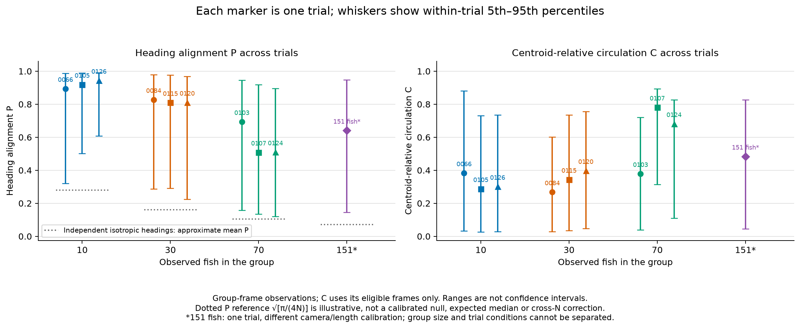
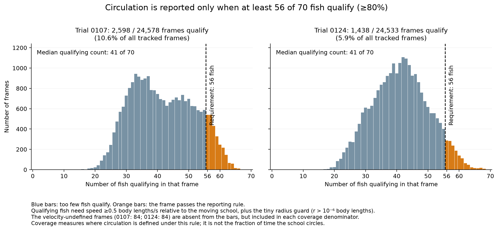
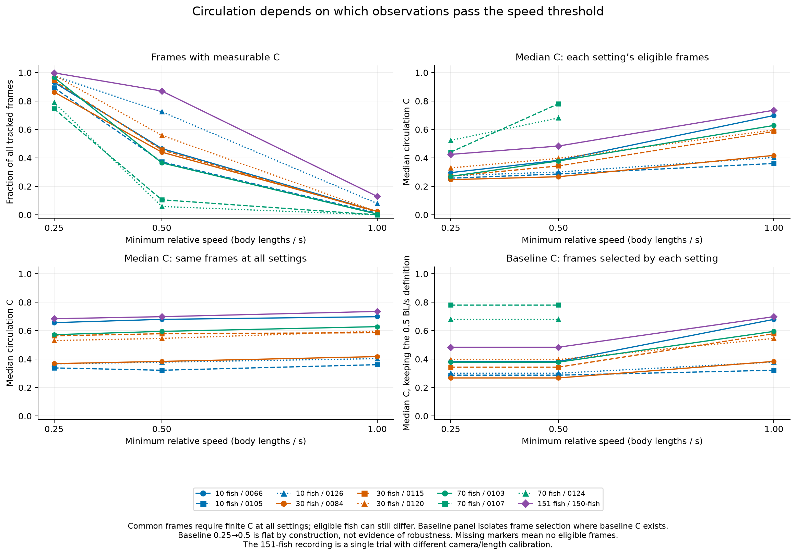
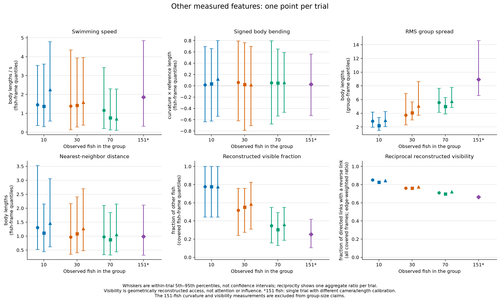
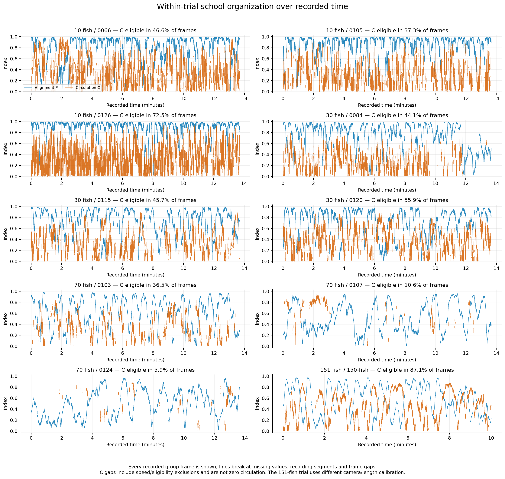

# Ten-trial golden-shiner comparison

**The clearest repeated pattern is lower global heading alignment across the 10-, 30- and 70-fish recordings. Circulation is much more variable and strongly dependent on which frames pass the relative-speed cutoff.** The single 151-fish recording does not extend a simple monotone pattern: its median alignment and circulation lie within the ranges of the 70-fish trials.

This extends the same five descriptive chapters to all ten trials: 10,827,539 fish-frame track rows, 266,688,111 directed visual-network rows, and 239,246 observed group frames. These are measurement counts, not independent experimental replicates. There are three trials at each of N=10, 30, 70 and one at N=151. No force, leadership, response-propagation or causal model has been fitted.

## 1. Alignment and circulation: what repeats

Each marker is one trial's median. Whiskers show that trial's 5th–95th percentiles over eligible frames, **not confidence intervals**. The statement that group medians separate concerns the markers, not the overlapping whiskers. P is the length of the mean heading vector, from 0 to 1; it is not the percentage of fish aligned. C is coherence of tangential movement around the moving group center after subtracting mean velocity. It is not angular speed or a validated milling classifier.

| Fish | Trial | Median P | P coverage | Median C | C coverage |
|---:|---|---:|---:|---:|---:|
| 10 | 0066 | 0.894 | 99.90% | 0.383 | 46.6% |
| 10 | 0105 | 0.919 | 99.80% | 0.287 | 37.3% |
| 10 | 0126 | 0.943 | 99.95% | 0.301 | 72.5% |
| 30 | 0084 | 0.827 | 99.13% | 0.268 | 44.1% |
| 30 | 0115 | 0.809 | 99.80% | 0.344 | 45.7% |
| 30 | 0120 | 0.811 | 99.64% | 0.397 | 55.9% |
| 70 | 0103 | 0.694 | 99.03% | 0.379 | 36.5% |
| 70 | 0107 | 0.509 | 99.29% | 0.781 | 10.6% |
| 70 | 0124 | 0.510 | 99.20% | 0.681 | 5.9% |
| 151 | 150-fish | 0.641 | 98.04% | 0.484 | 87.1% |

Coverage uses all observed group frames as its denominator. P excludes a frame when any fish's heading lies in the temporal support of a flagged large heading jump. C requires valid velocities and at least 80% of fish above 0.5 reference body lengths/s in centroid-relative speed. An undefined C is not zero circulation. The [trial table](tables/trials.csv) also gives velocity-defined frame counts and C coverage among those frames, separating boundary trimming from the relative-motion requirement.

Across the three trials in each smaller group, median P ranges are **0.894–0.943 (N=10), 0.809–0.827 (N=30), and 0.509–0.694 (N=70)**. Every 10-fish median exceeds every 30-fish median, and every 30-fish median exceeds every 70-fish median. This meets the comparison's predeclared, descriptive nonoverlap criterion. It survives raw-heading versus affected-fish-only summaries, exclusion of invalid-length frames, and restriction to the first 17,999 observed frames. P uses raw headings: changing the smoothing window changes P only through the heading-jump exclusion mask, so the window sweep is not an independent test of smoothing the alignment signal. With matched duration, the ranges are 0.882–0.945, 0.794–0.866, and 0.455–0.701.

This describes these recordings; it does not show that adding fish causes weaker social alignment. Global P can fall when different parts of a school move in different directions, including organized rotation. It does not measure local alignment or interaction strength. P also depends on N even for random headings. The dotted approximate-mean reference sqrt(pi/(4N)) is illustrative, not a calibrated null, expected median, significance threshold or correction. The 70-fish trials also have the lowest median speeds, so activity and global alignment co-vary here; speed-stratified alignment has not yet been analyzed. No experimental control or dependent-fish null was fitted.

Median C ranges are **0.287–0.383, 0.268–0.397, and 0.379–0.781** at N=10, 30, 70. Adjacent ranges overlap, so C does not meet the strict monotone criterion. The two high-C 70-fish trials, 0107 and 0124, have only 10.6% and 5.9% primary coverage. Calling them continuously circling schools, or treating those percentages as milling time, would exceed the evidence.

## 2. Why the circulation cutoff matters

This diagnostic counts qualifying fish in each velocity-defined frame. The rule
requires at least 56 of 70 fish; both trials have a median of only 41. Trial 0107
has 2,598 eligible frames out of 24,578 (10.57%); trial 0124 has 1,438 out of 24,533
(5.86%). Only 84 frames in each trial have undefined velocities. Those frames are
outside the histogram but remain in the coverage denominator. The other exclusions
come from the relative-speed/radial-direction rule, not absent track rows. Lowering
only the relative-speed cutoff to 0.25 BL/s raises coverage to 74.6% and 79.1%.
School-relative speed can be small even when fish swim rapidly together. These
percentages measure eligibility under our chosen rule, not time spent circling.

The upper-left panel shows how much data remains; upper-right shows each cutoff's median on its own selected frames. Lower-left holds frames fixed at those qualifying at all three cutoffs, which is exactly the 1.0-eligible, high-relative-motion subset. Fish contributing within those frames can still differ. Lower-right keeps the 0.5-cutoff C calculation fixed and changes its overlapping frame set. Its flat segment from 0.25 to 0.5 is identical by construction, not evidence of robustness. Missing C markers mean undefined summaries, never zero. Eligibility also depends on group size and how fish speeds co-vary under the requirement that at least 80% of fish qualify; coverage is not a group-size-neutral estimate of time spent circling.

Trial 70-fish/0107 illustrates the main selection issue. At 0.25 BL/s, C is measurable in 74.6% of frames and its median is 0.441. At 0.5, coverage falls to 10.6% and the median becomes 0.781. At 1.0 there are no eligible frames; the prespecified three-way intersection is therefore empty. Trial 0124 also has no 1.0-eligible frames.

An explicitly exploratory [pairwise comparison](tables/threshold-pairs.csv) uses the 2,598 frames shared by 0.25 and 0.5 in 0107. On those same frames, the lower-cutoff median is already 0.742, compared with 0.781 at the higher cutoff. Most of the difference from 0.441 to 0.781 therefore reflects selection of different moments; a smaller part reflects which fish contribute within those moments. These are descriptive differences between medians, not causal effects or independent-frame tests. All 30 threshold pairs, including undefined comparisons, are retained with [provenance](tables/threshold-pairs-manifest.json).

The focal fish's contribution to school-average velocity was also checked. Subtracting the other-fish mean rescales relative velocity by N/(N−1), leaving directions unchanged. Applying the equivalent threshold increases C coverage by 0.29–10.45 percentage points across these trials; the largest absolute change in median C is 0.0246. It does not rescue a monotone group-size ordering. This is a cutoff sensitivity, not a correction to the valid moving-centroid description.

## 3. Movement, posture, school size, spacing and visual access

The table gives the range of the three trial estimates in each smaller group. Movement, spread and spacing use trial medians; visibility uses each trial's mean fraction/degree and its pooled reciprocal-edge fraction.

| Measurement | N=10 | N=30 | N=70 |
|---|---:|---:|---:|
| Median speed, BL/s |1.376–2.259|1.378–1.593|0.713–1.160|
| Median RMS radius, BL |2.202–2.970|3.707–5.069|4.979–5.751|
| Median nearest-neighbor spacing, BL |1.114–1.467|0.968–1.274|0.876–1.063|
| Mean visible neighbors |6.555–6.929|14.777–16.979|21.565–25.321|
| Mean fraction of other fish visible |72.83–76.99%|50.95–58.55%|31.25–36.70%|
| Reciprocal-edge fraction |82.73–85.08%|76.17–77.57%|69.83–72.25%|

**Movement:** all three 70-fish trials have lower median swimming speed than every 10- or 30-fish trial. This survives matching duration. The 10- and 30-fish ranges overlap, so there is no strict three-group monotone speed ordering. Trial 0084 is duration-sensitive: median speed changes from 1.378 to 1.703 BL/s in the first 17,999 frames, an increase of 23.6%. Recorded speed differences should not be treated as context-free properties of group size.

**Posture:** signed curvature and turn-rate distributions include both signs and overlap between groups. Recorded signed-curvature medians are positive in all ten trials (0.015–0.123); this could reflect biological asymmetry or pose-reconstruction bias. The sign also follows the chosen image-coordinate and head-to-tail conventions; it is not by itself evidence of an anatomical left-right preference. Signed summaries can hide cancellation and do not measure turning or bending intensity. The curvature estimate comes from a local cubic fit around the midpoint of the recorded midline; it is not a direct force measurement. No robust monotone claim about bending intensity is made.

**School organization and spatial relationships:** school-spread medians separate between N=10 and 30, but the N=30 and 70 ranges overlap at full duration and separate only in the matched prefix. Some footprint growth is geometrically expected when more fish occupy a group at comparable local spacing. Typical nearest-neighbor distances remain around one reference body length. The group center is the arithmetic mean of smoothed fish positions; RMS radius is the square root of mean squared distance from that center. A strict three-group spread ordering is therefore not robust to the time window. Nearest spacing overlaps between adjacent group sizes. A larger total school footprint does not by itself establish wider local spacing.

**Visual access:** the number of geometrically visible neighbors rises across 10→30→70, while the fraction of the group visible and reciprocal-edge fraction fall. The adjacent ranges do not overlap, and these orderings survive matched duration and removal of invalid-length frames. These are properties of the supplied ray-cast geometry; occlusion and the growing number of potential neighbors can themselves produce size-dependent degree and visible fraction. They do not establish attention, information use, response strength or influence. An observed edge means observer id1 sees id2; reciprocity is the fraction of directed edges with a reverse edge, pooled over covered frames.

## 4. The 151-fish recording is a separate comparison

Its median P is 0.641 and C is 0.484, with C defined in 87.1% of observed frames. Both medians lie within the 70-fish ranges. Its median speed is 1.861 BL/s, above the 70-fish range, so the lower speed observed at 70 does not continue in this recording.

It contains 17,999 frames in one segment with no internal missing frames, versus seven segments and six missing join frames in each smaller trial. It uses a different camera, and the source reports visible bodies about 15% longer than the stored reference length. With the illustrative L×1.15 scenario, speed becomes 1.618 BL/s, RMS radius changes from 8.927 to 7.763 BL, and nearest spacing from 0.985 to 0.857 BL. Reapplying the circulation cutoff reduces coverage from 87.1% to 77.4% and changes median C from 0.484 to 0.507. P is unchanged by this length rescaling.

This scenario is not a calibrated correction: it cannot repair anatomical midline differences or regenerate the visual network from corrected outlines. **The 151-fish curvature and visibility measurements are excluded from group-size claims.** One recording under different conditions cannot establish a group-size effect. Source timing is 29.97 fps and time=frame/29.97; we have not independently verified this video's timing or camera orientation. Signed circulation is not compared across cameras.

## 5. Quality checks, time series and what remains uncertain

Time series retain every observed group frame and break at segment boundaries, gaps and undefined measurements. They show variation during each recording; no persistence scale, transition rate or state-duration estimate is claimed.

The measured input columns passed finite-value, complete-fish-set, unique-key and within-block timing checks. Every network row was processed and checked, including duplicate edges, endpoints, ray/angular consistency and distances. Every observed track frame had a represented network, so covered-frame degree summaries include zero-degree fish. Entirely missing edge-list frames would remain unknown. This audits the selected measurement columns and supplied geometry; it does not validate unused pose columns or prove that tracking identities and headings are biologically correct.

There are 22 nonpositive-length fish observations across 14 trial-frames, with collapsed posture geometry. Reference L uses positive lengths only and curvature is undefined on those rows. Primary finite positions/headings and the supplied network remain recorded measurements. A separate sensitivity removes affected frames, recomputes motion with gap guards, and excludes those frames from network summaries. The largest changes in median P and C are only 0.000110 and 0.0000731, respectively. This demonstrates robustness of these summaries to those particular flagged frames, not that all tracking errors have been eliminated.

Primary P coverage is 98.0–99.95%. Dropping only affected fish instead of entire heading-flagged frames changes median P by at most 0.00144 and preserves the 10→30→70 ordering. Added-frame P summaries and all changing denominators are retained in the compact tables. Heading anomalies remain candidates for video inspection; they are not established head-tail flips. Suggested source-frame windows include 0084: 17057–17066; 0107: 9949–9958 and 19468–19478; 0103: 16807–16831; 0124: 18690–18716. Simultaneous anomalies could be tracking defects or real rapid collective turns, which must be checked against video. No additional videos were inspected for this comparison; the original pilot retains its earlier selected overlays.

**Computational QA:** the original comparison suite passed 131 tests and 8 subtests; the [publication suite](../test-results-publication.txt), including the eligibility diagnostic, passes 137 tests and 17 subtests. The [validator](validation.json) verifies all recorded input/source/output hashes and identical analysis source/config across the ten runs. All ten primary quantile dictionaries and network summaries for 0066 exactly reproduce the pilot. The largest absolute difference among fifty independently recalculated sampled P values is 2.220446049250313×10⁻¹⁶ (approximately 2.22×10⁻¹⁶). This is coordinator-run QA, not an independent rerun of every metric.

**Review status:** Claude Opus 5.5 independently passed the [implementation snapshot](../../docs/workflow/reviews/comparison-implementation/review.md); its [notes were dispositioned](../../docs/workflow/reviews/comparison-implementation/adjudication.md). The [numerical-results review](../../docs/workflow/reviews/comparison-results/review.md) found no contradiction or rerun-level defect and requested narrative corrections. The corrected report received [PASS in focused confirmation](../../docs/workflow/reviews/comparison-results-fixes/review.md), accepted for local sharing with the stated caveats; see the [final disposition](../../docs/workflow/reviews/comparison-results-fixes/adjudication.md). Claude receives explicit source/results text without tools: it does not execute the data pipeline or inspect rendered images. The coordinator inspected the plots. Independent computational reproduction remains a separate unfinished gate.

## A defensible Monday summary

“We extended the descriptive analysis to all ten recordings. Across the three trials at each of 10, 30 and 70 fish, larger groups had lower whole-school heading alignment; that ordering survived our heading-filter, matched-duration and flagged-geometry checks. Circulation varied substantially between trials and depended strongly on the relative-speed cutoff, so we cannot yet label milling states or infer how long they lasted. Typical local spacing stayed around one body length, while geometric visual access covered a smaller fraction of larger groups. The single 151-fish recording’s alignment fell within the 70-fish range, so it does not extend the ordering; it also has a different camera. These results identify behavior to investigate; they do not yet identify social forces, leadership or causation.”

## Files and reproduction

[Trial estimates and denominators](tables/trials.csv) · [Threshold summaries](tables/thresholds.csv) · [All sensitivity values](tables/sensitivity.csv) · [Metric quantiles](tables/metrics.csv) · [Plot inputs](plot-manifest.json) · [Run log](run-log.txt) · [Download verification](download-log.txt).

Per-trial summaries, configs, histogram tables and provenance are in `trials/<trial>/`. Large frame-level CSVs remain local ignored caches; scripts regenerate them. Raw tracks/networks stay in ignored `data/trials/`, outside Git. PNG figures have matching editable-text SVGs. Use the [repository reproduction commands](../../README.md#compare-all-ten-trials) with a new output directory. Measurement definitions and predeclared comparison criteria are in [comparison methods](../../docs/comparison-methods.md) and [pilot methods](../../docs/methods.md).

The next scientific work is to inspect selected high-C intervals against video, compare local versus global alignment, and then test predictive response models with explicit nulls and a validation protocol that accounts for exposure to all ten trials. Independent computational reproduction is still required before treating this as a fully independently verified release. Marco authorized publication of this descriptive package on November 7, 2026; the [session account](../../docs/session-summary.md) and [workflow status](../../docs/workflow/status.md) record its scope and review evidence.
