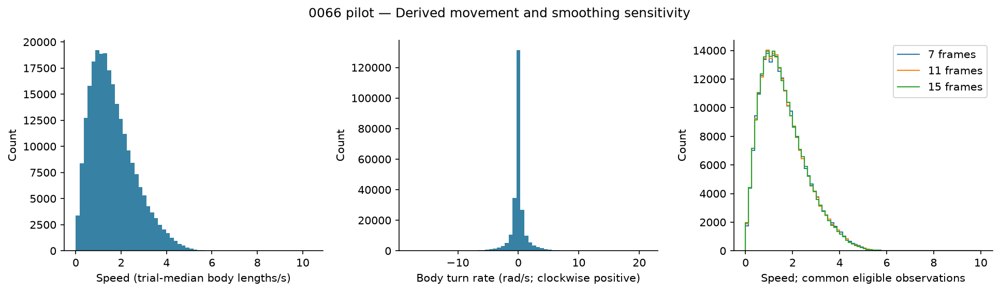
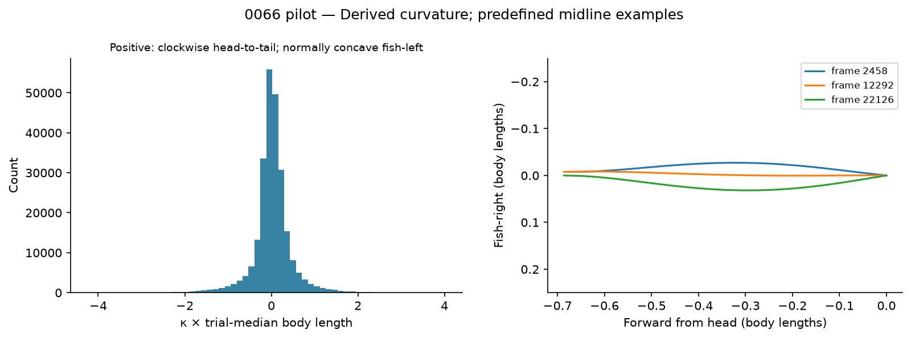
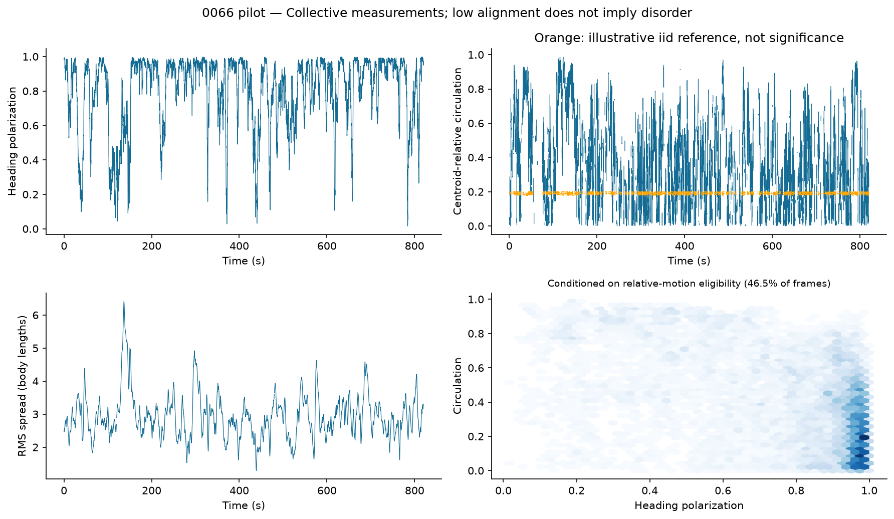
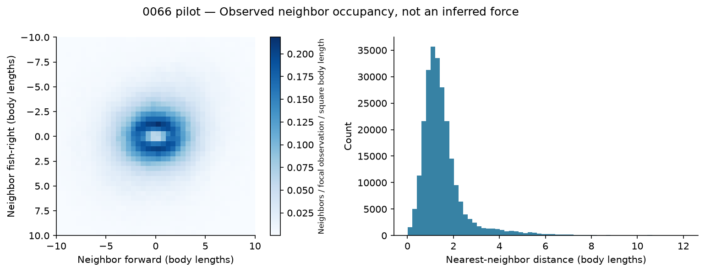
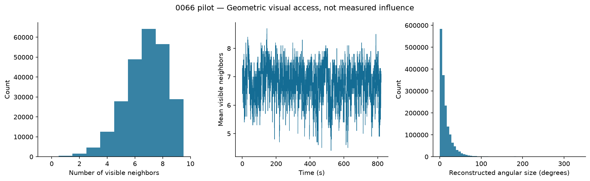
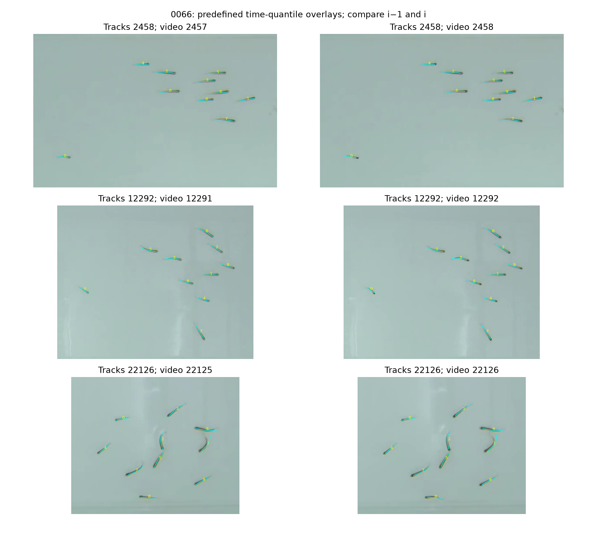

# Golden shiners: first descriptive atlas

**Scope:** retained historical pilot of one 10-fish trial, `0066`, approximately 13.7 minutes. The subsequent [ten-trial comparison](comparison/README.md) is now available. No social-force model, leadership analysis or causal inference has been fitted.

OpenAI implemented and executed the analysis. Claude Opus 5.5 reviewed the methods and requested corrections before the real run. Claude’s [follow-up implementation review](../docs/workflow/reviews/M1-fixes/review.md) passed its stated static-review scope, with no remaining material correction. Actual milestone status is tracked in [workflow status](../docs/workflow/status.md). Tool-free Claude review is independent reasoning, not independent execution. The strict reproduction/release gate remains pending.

## What we can trust so far

The tables contain 245,780 fish-frame observations, 24,578 tracked frames and 1,662,869 directed visibility links. Required values are finite, keys are unique, each frame contains all ten fish, and all network endpoints match tracks. Stored network distances agree with recomputed center distances to numerical precision. Seven recording segments are separated by six missing frames; derivatives do not bridge them.

Four fish-frame rows were flagged around two large heading changes. Their smoothing support was excluded from turn rate, slip and polarization; the occupancy map deliberately retains raw headings. No head-to-tail axis disagreement exceeded 90 degrees. This is a QA check, not proof that all identities/headings are correct. The two events occur on **different fish**: fish 2 at frame 18174 (+1.710 rad), and fish 1 at frame 20279 (+1.892 rad), both in segment 5. They do not bracket a flip/unflip interval on one fish. Separately, **266 of 222,181 speed-eligible rows (0.120%)** have travel direction more than 90 degrees from recorded heading. The longest such run is fish 3, frames 15808–15830 (23 frames). These unresolved candidates may reflect backward motion or tracking/derivative defects; axis agreement does not rule out simultaneous head/pose reversal. No automatic heading correction was applied. This check cannot rule out heading errors among the roughly 9.6% of observations outside speed eligibility, including slow motion and derivative boundaries. The exact events and longest run per fish are retained in summary.json, and these intervals require targeted video review before strong heading-based interpretations.

The shared descriptive scale is median body length **38.99 pixels**. Values below use this trial-wide scale, not centimeters or each fish's individual length. Percentiles are descriptive; fish-frames are dependent and are not independent experimental replicates.

## 1. Movement: typical speed is stable under modest smoothing changes

**Claim B1-01 — derived measurement.** Median smoothed speed is **1.453 body lengths/s**; the 5th–95th percentile range is **0.355–3.531**. The speed distributions are similar across cubic 7-, 11- and 15-frame filters, compared on common eligible rows. This checks robustness over these settings, not every possible preprocessing choice.

The primary filter uses 11 frames, actual within-block timestamps and a half-window-plus-one exclusion at both block ends. Speed retains 244,940 observations (99.66%). Turn rate excludes heading-jump support and retains 244,916. Positive turning is clockwise in image coordinates. Histograms pool eligible fish-frame observations equally; the sensitivity panel displays speeds from 0 to 10 body lengths/s, while the summary table retains all finite values. There are no confidence intervals.

Acceleration and slip are available in the numerical summary but are not headline behavioral claims. An approximate residual-based acceleration noise diagnostic is about 0.44–0.48 body lengths/s² per coordinate; its independence assumptions are not established. It must not be treated as calibrated measurement uncertainty.

Evidence: [summary](pilot-0066-reviewed/summary.json), [speed sensitivity](pilot-0066-reviewed/tables/speed-sensitivity.csv), [methods](../docs/methods.md), run `pilot-0066-reviewed`.

## 2. Posture: a measurable distribution, with explicit sign conventions

**Claim B2-01 — derived geometry.** Dimensionless midpoint curvature (κ times trial-median body length) has a median of **0.015**, with 5th–95th percentiles **−0.636 to 0.694**. The distribution concentrates near straight posture, with bent configurations in both directions. This does not show that bending causes subsequent turns.

A cubic spatial fit uses seven midline points centered at point 10. All 245,780 rows are geometrically eligible. Sensitivity uses 5-, 7- and 9-point fits on the common finite set. Positive curvature is clockwise tangent rotation along the head-to-tail path; for a tailward tangent opposing body heading, this corresponds to concavity toward fish-left. It is not the positive-right-turn convention. Curvature is sensitive to pose reconstruction and the fitting neighborhood.

The three midline examples are from the lowest numeric ID at predefined 10%, 50%, 90% time quantiles (frames 2458, 12292, 22126), translated to the head and rotated into the measured body frame. They are illustrative selections, not a claim of representative posture frequency. Axes have equal length scales.

Evidence: [curvature histogram](pilot-0066-reviewed/tables/curvature.csv), [curvature sensitivity](pilot-0066-reviewed/tables/curvature-sensitivity.csv), [methods](../docs/methods.md), run `pilot-0066-reviewed`.

## 3. Organization: alignment varies, but circulation needs caution

**Claim B3-01 — derived collective measurement.** Median heading polarization is **0.894**, with repeated low-alignment episodes. Low alignment alone does not distinguish disorganization from coordinated circulation. RMS distance from the group centroid has a median of **2.844 body lengths** on eligible frames.

Time traces break at recording gaps and segment changes. Polarization uses body headings, with conservative SG-support frames around detected heading steps excluded (not all possible sustained flips) (24,554 frames retained). Spread uses smoothed positions and retains 24,494 frames. Circulation alone qualifies on 46.6% of frames; the alignment–circulation map additionally requires valid polarization and contains 46.5% of frames. This selection depends on relative motion and is not independent of polarization. It is not the joint distribution of the whole recording; darker bins contain more frames and do not represent an inferential probability model.

**Claim B3-02 — sensitivity result.** Centroid-relative circulation is highly sensitive to the low-speed eligibility threshold. At thresholds of 0.25, 0.5 and 1.0 body lengths/s, **93.2%, 46.6% and 2.3%** of frames qualify, respectively. The corresponding medians are 0.297, 0.383 and 0.699. These summarize different selected subsets, so the increasing median is not evidence that changing the threshold changes fish behavior.

The primary circulation threshold is 0.5 body lengths/s and requires at least 8/10 eligible fish. Its sign is saved separately. The orange reference is the approximate mean absolute score for independent isotropic directions, about 1/sqrt(pi*n); actual centroid-relative velocities are dependent. Rigid group rotation can also give C=1. It is **not** a significance threshold or a validated milling classifier. We withhold a headline claim about the fraction of time spent milling.

Evidence: [collective time series](pilot-0066-reviewed/tables/collective.csv), [threshold sensitivity](pilot-0066-reviewed/tables/threshold-sensitivity.csv), [methods](../docs/methods.md), run `pilot-0066-reviewed`.

## 4. Spacing: nearest neighbors are commonly about one body length away

**Claim B4-01 — descriptive spatial measurement.** Median nearest-neighbor center distance is **1.309 body lengths**, with 5th–95th percentiles **0.525–3.531**. The all-neighbor occupancy map shows a lower-density central region surrounded by more frequent neighbor locations. This could reflect geometry, spacing behavior and boundary effects; it is not a repulsion-force estimate.

The map includes all ordered focal-neighbor pairs, excluding self-pairs, across all 245,780 focal observations. Horizontal means forward; vertical means fish-right increasing downward. Bins are 0.5×0.5 body lengths within ±10 in each direction. Density is divided by all focal observations and bin area; **98.61%** of ordered pairs fall within the displayed range. The nearest-neighbor histogram uses all finite distances, including observations outside the map. Arena/wall effects have not been controlled. This occupancy map rotates by all raw headings, including heading-jump support and the unresolved reverse-motion candidates; those possible defects are disclosed rather than silently corrected.

Evidence: [spatial map data](pilot-0066-reviewed/tables/spatial-map.csv), [nearest-distance histogram](pilot-0066-reviewed/tables/nearest.csv), [methods](../docs/methods.md), run `pilot-0066-reviewed`.

## 5. Visual access: broad, changing geometric access to neighbors

**Claim B5-01 — geometric reconstruction.** Fish see **6.766 of 9 neighbors on average**, with median 7, and **85.08%** of directed links have a reverse link in the same frame. Visibility varies over time. These quantify the supplied ray-cast network; they do not measure attention or influence.

All tracked frames have network coverage in this trial. Degree includes zero-degree fish; 245,780 observer-frame values are counted equally. Reciprocity is pooled over directed edges, not an unweighted average of frame fractions. Angular size is distributed over all 1,662,869 edge observations, with source convention 0.36 degrees per ray. Persistence is not implemented in this pilot.

Evidence: [degree histogram](pilot-0066-reviewed/tables/degree.csv), [visibility time series](pilot-0066-reviewed/tables/visibility-time.csv), [methods](../docs/methods.md), run `pilot-0066-reviewed`.

## Video correspondence

Tracks at frames 2458, 12292 and 22126 are compared with video frame i−1 and i. Cyan lines show midlines; yellow labels show IDs. Images are cropped to the school for inspection, not to infer arena geometry. The coordinator inspected these qualitative examples: the overlays follow the visible fish at the group scale, but these samples do not establish pixel-level tracking error or resolve the one-frame ambiguity. No continuous identity audit or quantitative alignment accuracy is claimed.

## What this pilot motivates next

The supported narrative is: the trial contains variable individual movement, measurable body bending, episodes of differing alignment and spread, structured neighbor occupancy, and changing reconstructed visibility. The analysis also exposes a consequential choice: circulation summaries depend strongly on which low-speed observations are excluded.

The same quality/measurement pipeline has since been extended across all ten trials; see the comparison linked above. Independent computational reproduction and targeted video review of flagged/low-alignment episodes remain open. Response maps can then test whether neighbor location or visibility predicts subsequent turning. Neither leadership nor pairwise sufficiency has been established here.

## Reproduction and review

From the repo root: `uv sync --frozen`, `uv run python scripts/fetch_pilot.py --video`, `uv run pytest -q`, then `uv run shiners-pilot --output reports/my-new-run`. Use a new output directory. Data are cached outside Git; the source dataset release remains unchanged.

[Run provenance](pilot-0066-reviewed/provenance.json) records source/input hashes, environment, config and output hashes. [Test log](test-results-final.txt) records coordinator-executed tests. [Review decisions](../docs/workflow/decisions.md) and [workflow status](../docs/workflow/status.md) track exactly what Claude reviewed and what remains pending. All claims B1-01 through B5-01 share the pilot-only limitation and passed the stated static review; independent execution and targeted anomaly-video checks remain outstanding. This report is not a final scientific release.
